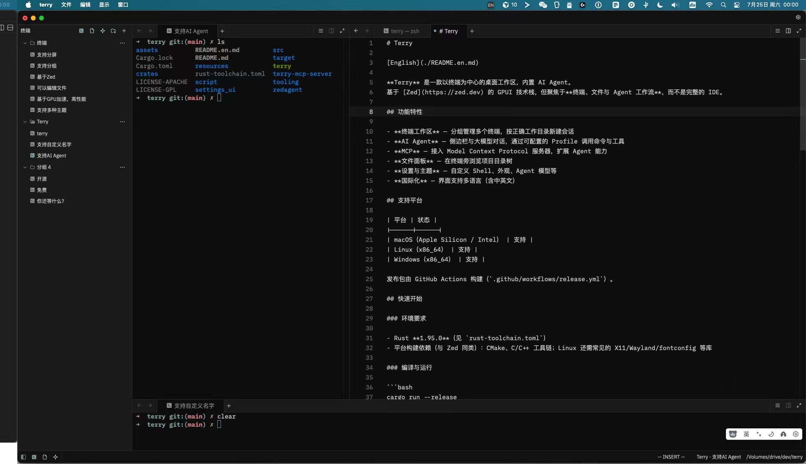
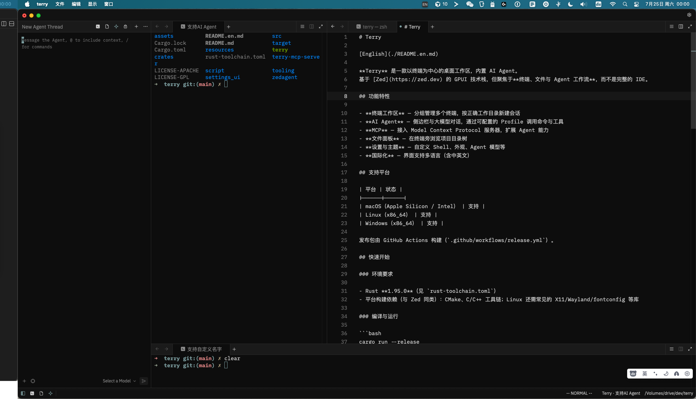
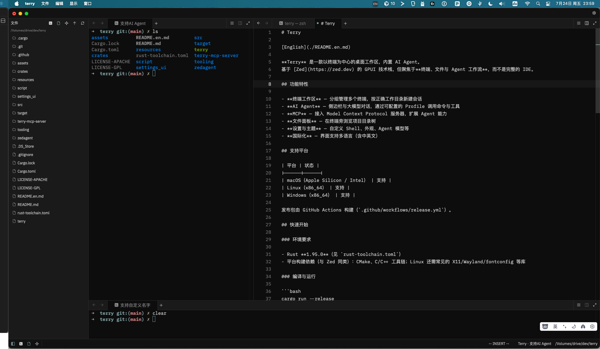

# Terry

[中文](./README.zh.md)

**Terry** turns your terminal into a workspace.  
Group shells, browse files, and keep an AI agent beside you — built for people who live in the command line.

## Preview

<p align="center">
  
</p>
<p align="center">
  
</p>
<p align="center">
  
</p>

## Features

- **Terminal workspace** — group multiple terminals, switch groups with `ctrl-alt-shift-up` / `ctrl-alt-shift-down`; new sessions open in the right working directory; groups support automatic tiling layouts (manual / splits / tall / fat / grid / stack / horizontal / vertical, kitty-style); enable **broadcast input** from a group's context menu to type into every terminal in the group at once (`ctrl-alt-b`)
- **Tab management** — `cmd-shift-t` (`ctrl-shift-t`) reopens the most recently closed terminal with its cwd, profile/SSH/tmux launch, colors and font zoom; “Move Tab to New Window” moves a running terminal, process intact, into a new window
- **Quake terminal** — A drop-down terminal summoned anywhere with `ctrl+\`` , docked to the top of the screen (macOS)
- **CLI** — Drive a running Terry from scripts and editors: `terry new-tab --cwd ~/src`, `terry send-text "cargo test"`, `terry run "cargo test"`, and `terry session save/load` for reusable workflows
- **Kittens / plugins** — executable extensions discovered from `kittens/` directories, launched with `terry kitten list` / `terry kitten run NAME`; they receive `TERRY_*` context and the automation API. This is Terry's plugin contract, not a drop-in implementation of kitty's Python kitten API
- **Terminal images** — kitty graphics protocol and sixel support for rendering images directly in the terminal, with animated GIFs (`chafa` / `viu` / `icat` work)
- **Terminal protocols** — kitty keyboard protocol (CSI u with press/repeat/release events, alternate keys, and associated text), OSC 52 clipboard write (clipboard *read* is opt-in via `"terminal": { "clipboard_read": true }`), OSC 99 desktop notifications, OSC 22 mouse pointer shapes, OSC 66 text sizing, CSI 8 t window resize, and Unicode grapheme clustering (emoji ZWJ sequences, flags, keycaps, combining marks)
- **Paste safety** — multi-line pastes ask for confirmation by default; choose “Paste and Don't Ask Again” in the prompt to stop asking, or set `"terminal": { "confirm_multiline_paste": false }`
- **Shell integration** — automatic for zsh and fish: prompt marks (OSC 133 / VS Code OSC 633) and working-directory tracking (OSC 7); `ctrl-shift-up` / `ctrl-shift-down` move between prompts
- **Terminal profiles** — named launch profiles can override the shell, environment, and working directory, and run a startup command (for example `tmux` or a project virtualenv); pick one from a group's context menu or set `default_profile`
- **SSH hosts** — a picker built from `~/.ssh/config` and `terminal.ssh_hosts`; connections are reused for 60s (`ControlMaster`), so a second terminal on the same host opens instantly. “Connect with tmux” starts an attach-or-create tmux session on the remote host
- **tmux sessions** — attach to (or create) a local tmux session from the picker; the remote equivalent goes through `ssh … tmux new -A -s <name>`. Choose the native option to mirror the session through tmux *control mode*: every tmux window becomes a Terry group and every pane a native split, with input, layout changes, window names and reconnects kept in sync. Without native mode the session runs inside a single terminal.
- **Terminal color schemes** — a bundled library (Dracula, Nord, Solarized, Gruvbox, One Dark, Tokyo Night, Catppuccin, Rosé Pine, …) that changes only terminal colors; pick one per terminal, per profile, or with `terminal.color_scheme`. Import Alacritty `.toml`, iTerm2 `.itermcolors`, or Terry JSON files from the Terminal menu
- **Session restore** — groups, split layouts, working directories, titles, per-profile color schemes, per-terminal font zoom, and profile/SSH/tmux launches are restored on restart
- **Hints** — `Ctrl+Shift+E` lists visible URLs, paths, git hashes, UUIDs, IPs, and custom regex matches; choose one with the keyboard to open, copy, paste, or select. Add custom rules under `terminal.hints`, for example `{ "regex": "#\\d+", "action": "copy" }`
- **AI Agent** — Chat with LLMs in a side panel; run commands and tools with configurable profiles
- **MCP** — Connect Model Context Protocol servers to extend agent capabilities
- **Files panel** — Browse the project tree alongside your terminals
- **Editor** — Open text from the files panel, or with New File / Open File; files share tabs and splits with terminals. Vim mode is on by default, with in-file search and go to line. Markdown can be previewed, and images open in a viewer
- **Settings & themes** — Customize shell, appearance, agent models, and more
- **i18n** — UI strings available in multiple locales (including English and Chinese)

## Shell integration

Terry parses **OSC 133** prompt marks (including the VS Code **OSC 633** variant) and **OSC 7** working-directory reports. With integration active, `ctrl-shift-up` / `ctrl-shift-down` move between prompts, and the last command line is recorded so it can be selected or re-run.

- **zsh and fish** work out of the box. Terry writes its integration scripts to its data directory (on macOS: `~/Library/Application Support/Terry/shell-integration`) and injects them automatically — no dotfile changes needed. Disable it with `"shell_integration": false` in the `terminal` section of your settings.
- **bash** is supported manually — add one line to `~/.bashrc`:

  ```bash
  [ -n "$TERRY_INTEGRATION_DIR" ] && . "$TERRY_INTEGRATION_DIR/bash/terry.bash"
  ```

  (Works with the system bash on macOS; if [bash-preexec](https://github.com/rcaloras/bash-preexec) is loaded, Terry hooks into it automatically.)

Remote shells launched as `ssh` are skipped, and task runs never get integration.

## CLI

A running Terry instance listens on a local IPC socket (token-protected; connection info in `ipc.json` under your data directory). The `terry` binary doubles as the client:

```sh
terry new-tab --cwd ~/src          # open a new tab in the active window
terry send-text "cargo test"       # paste text into the active terminal
terry run "cargo test"             # paste text and press Enter
terry session save "Work"          # save the active group as a session template
terry session load "Work"          # create a new group from that template
terry session list                 # list saved templates
terry session delete "Work"        # delete a template
terry kitten list                  # list installed kitten/plugin executables
terry kitten run hello --arg       # run a kitten (or: terry kitten hello --arg)
terry kitten path                  # show plugin search directories
```

`send-text` pastes without executing — it never appends a newline. `run`
pastes and submits the command. A session template stores the group's terminals,
working directories, profiles/launches, tiling layout, and broadcast setting.

Kittens are executables (with a shebang on Unix) in `$TERRY_KITTEN_PATH`, the
`kittens/` directory under Terry's config directory, or the `kittens/` directory
under its data directory. They run with inherited stdio and receive
`TERRY_KITTEN_NAME`, `TERRY_KITTEN_DIR`, `TERRY_KITTEN_PATH`, `TERRY_PID`,
`TERRY_IPC_URL`, `TERRY_IPC_TOKEN`, `TERRY_CONFIG_DIR`, and `TERRY_DATA_DIR`, so
they can call the automation API or the `terry` CLI. Kittens are trusted local
executables and receive the IPC token, so only install plugins you trust.
Kitty's Python kitten API is not provided; existing kittens need porting to this
contract.

Starting `terry` while an instance is already running focuses that instance instead of launching a second process, and prints the pid of the instance it handed the launch to. Use `terry --new-instance` to start a second process anyway (handy when running a freshly built binary next to an older one).

### Automation API

The same bearer-protected loopback server also accepts JSON requests:

- `/api/list_sessions` — groups, group ids, layouts, terminal ids, titles, cwd, and running commands
- `/api/focus_session` — focus a terminal by `terminal_id` / `session_id`
- `/api/focus_group` — switch to a group by `group_id`
- `/api/send_keys` — send text or a keystroke such as `ctrl-c`
- `/api/run` — paste text and optionally press Enter (`"enter": false` to skip)
- `/api/read_screen` — read a terminal's content as plain text
- `/api/get_context` — active terminal title, cwd, group, and command
- `/api/close_session` — close a terminal without prompting (or the active one when no id is given)
- `/api/detach_session`, `/api/reattach_session`, `/api/list_detached` — keep a terminal alive outside a group and attach it again later
- `/api/rename_session` — set or clear a terminal title (`"title": null` clears it)
- `/api/new_group`, `/api/delete_group` (terminates its terminals), `/api/rename_group` — manage groups
- `/api/move_session` — move a terminal to another group
- `/api/set_group_layout` — `manual`/`splits`, `tall`, `fat`, `grid`, `stack`, `horizontal`, or `vertical`
- `/api/list_session_templates`, `/api/save_session_template`, `/api/load_session_template`, `/api/delete_session_template` — reusable workflow templates
- `/api/set_broadcast` — enable/disable broadcast input for a group
- `/api/scroll` — `top`, `bottom`, `page_up`, `page_down`, `line_up`, or `line_down`
- `/api/set_font_size`, `/api/set_color_scheme` — per-terminal display overrides (`null` clears them)
- `/api/notify` — post a desktop notification
- `/api/new_tab`, `/api/send_text`, `/api/focus`, `/api/new_window`

## Command output

With shell integration active, Terry tracks each command's boundaries and exit code (`OSC 133;C/D`):

- `cmd-alt-u` (macOS) / `ctrl-alt-u` (Linux, Windows) copies the previous command's output to the clipboard
- `cmd-alt-shift-u` / `ctrl-alt-shift-u` selects the previous command's output
- `cmd-alt-shift-r` / `ctrl-alt-shift-r` re-runs the previous command
- The status bar shows the last failed command's exit code, e.g. `group · title · exit 1`
- Optional command-finished notifications (Settings → Terminal) and OSC 9 progress in the tab title
- Terminal search (`cmd-f`) supports case-sensitive, whole-word, and regex modes

## Platforms

| Platform | Status |
|----------|--------|
| macOS (Apple Silicon / Intel) | Supported |
| Linux (x86_64) | Supported |
| Windows (x86_64) | Supported |

Release packages are built via GitHub Actions (`.github/workflows/release.yml`).

## Getting started

### Prerequisites

- Rust **1.95.0** (see `rust-toolchain.toml`)
- Platform build deps: CMake, a C/C++ toolchain, and on Linux the usual X11/Wayland/fontconfig libraries

### Build & run

```bash
cargo run --release
```

Config and data live under the app name **Terry** (for example `~/.config/terry/` on Linux, `~/Library/Application Support/Terry` on macOS).

### Package locally

```bash
# macOS
script/package-macos.sh

# Linux
script/package-linux.sh

# Windows (PowerShell)
.\script\package-windows.ps1
```

Artifacts are written under `target/release/`.

## Project layout

```
src/                 # App entry, terminal/file panels, menus
crates/              # Shared libraries (GPUI, terminal, agent, settings, …)
agent_ui / crates/agent_ui
assets/              # Icons, default settings, themes
script/              # Packaging scripts
resources/           # App icons and desktop metadata
```

## License

- Application package: **GPL-3.0-or-later** (see `LICENSE-GPL`)
- Many crates retain their upstream licenses (including Apache-2.0; see `LICENSE-APACHE` and per-crate metadata)

## Contributing

Issues and pull requests are welcome. Please keep changes focused; match existing code style, and test on the platform you touch.
