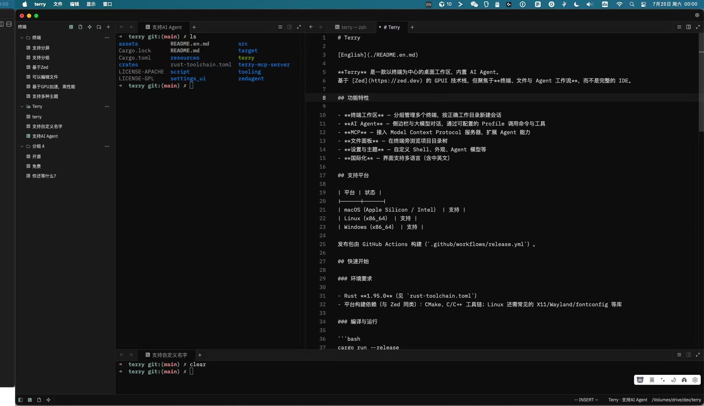
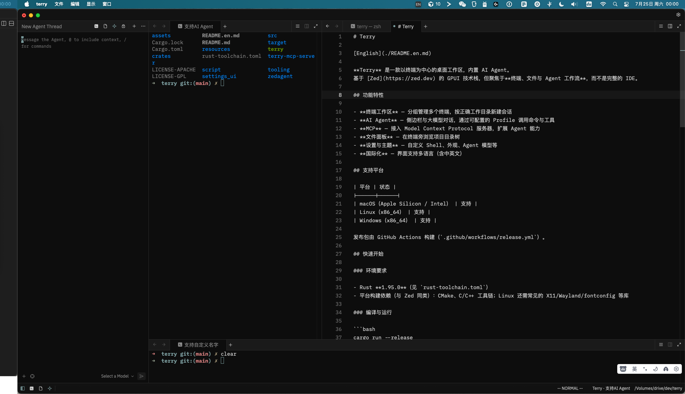
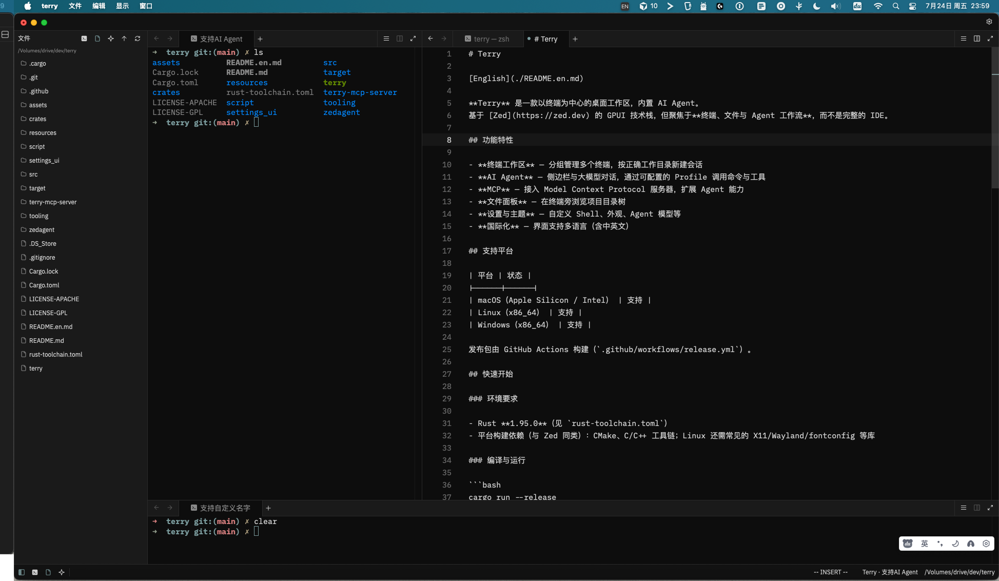

# Terry

[中文](./README.zh.md)

**Terry** turns your terminal into a workspace.  
Group shells, browse files, and keep an AI agent beside you — built for people who live in the command line.

## Preview

<p align="center">
  
</p>
<p align="center">
  
</p>
<p align="center">
  
</p>

## Features

- **Terminal workspace** — group multiple terminals, switch groups with `ctrl-alt-shift-up` / `ctrl-alt-shift-down`; new sessions open in the right working directory; groups support automatic tiling layouts (manual / splits / tall / fat / grid / stack / horizontal / vertical, kitty-style); enable **broadcast input** from a group's context menu to type into every terminal in the group at once (`ctrl-alt-b`)
- **Tab management** — `cmd-shift-t` (`ctrl-shift-t`) reopens the most recently closed terminal with its cwd, profile/SSH/tmux launch, colors and font zoom; “Move Tab to New Window” moves a running terminal, process intact, into a new window
- **Quake terminal** — A drop-down terminal summoned anywhere with `ctrl+\`` , docked to the top of the screen (macOS)
- **CLI** — Drive a running Terry from scripts and editors: `terry new-tab --cwd ~/src`, `terry send-text "cargo test"`, `terry run "cargo test"`, and `terry session save/load` for reusable workflows
- **Kittens / plugins** — executable extensions discovered from `kittens/` directories, launched with `terry kitten list` / `terry kitten run NAME`; they receive `TERRY_*` context and the automation API. This is Terry's plugin contract, not a drop-in implementation of kitty's Python kitten API
- **Terminal images** — kitty graphics protocol and sixel support for rendering images directly in the terminal, with animated GIFs (`chafa` / `viu` / `icat` work)
- **Terminal protocols** — kitty keyboard protocol (CSI u with press/repeat/release events, alternate keys, and associated text), OSC 52 clipboard write (clipboard *read* is opt-in via `"terminal": { "clipboard_read": true }`), OSC 99 desktop notifications, OSC 22 mouse pointer shapes, OSC 66 text sizing, CSI 8 t window resize, and Unicode grapheme clustering (emoji ZWJ sequences, flags, keycaps, combining marks)
- **Paste safety** — multi-line pastes ask for confirmation by default; choose “Paste and Don't Ask Again” in the prompt to stop asking, or set `"terminal": { "confirm_multiline_paste": false }`
- **Shell integration** — automatic for zsh and fish: prompt marks (OSC 133 / VS Code OSC 633) and working-directory tracking (OSC 7); `ctrl-shift-up` / `ctrl-shift-down` move between prompts
- **Terminal profiles** — named launch profiles can override the shell, environment, and working directory, and run a startup command (for example `tmux` or a project virtualenv); pick one from a group's context menu or set `default_profile`
- **SSH hosts** — a picker built from `~/.ssh/config` and `terminal.ssh_hosts`; connections are reused for 60s (`ControlMaster`), so a second terminal on the same host opens instantly. Plain SSH sessions automatically install shell integration for remote zsh, fish, and bash, and the status bar marks the terminal as remote with the host and the remote directory while the sidebar and tab follow the remote folder. “Connect with tmux” starts an attach-or-create tmux session on the remote host
- **tmux sessions** — attach to (or create) a local tmux session from the picker; the remote equivalent goes through `ssh … tmux new -A -s <name>`. Choose the native option to mirror the session through tmux *control mode*: every tmux window becomes a Terry group and every pane a native split, with input, layout changes, window names and reconnects kept in sync. Without native mode the session runs inside a single terminal.
- **Terminal color schemes** — a bundled library (Dracula, Nord, Solarized, Gruvbox, One Dark, Tokyo Night, Catppuccin, Rosé Pine, …) that changes only terminal colors; pick one per terminal, per profile, or with `terminal.color_scheme`. Import Alacritty `.toml`, iTerm2 `.itermcolors`, or Terry JSON files from the Terminal menu
- **Session restore** — groups, split layouts, working directories, titles, per-profile color schemes, per-terminal font zoom, and profile/SSH/tmux launches are restored on restart
- **Persistent sessions (opt-in)** — with `terminal.persistent_sessions` enabled, terminals are owned by a background daemon: they keep running after you quit Terry or close the window, and reattach with their scrollback when you come back. Closing a single tab detaches it (you are told once); reopen it with "Reopen Closed Terminal" or end it with `terry daemon kill`. Unix only for now
- **Hints** — `Ctrl+Shift+E` lists visible URLs, paths, git hashes, UUIDs, IPs, and custom regex matches; choose one with the keyboard to open, copy, paste, or select. Add custom rules under `terminal.hints`, for example `{ "regex": "#\\d+", "action": "copy" }`
- **Built-in coding agent** — [tom](https://github.com/bigfish1913/tom) ships inside Terry: type `tom` in any terminal to get a full terminal coding agent that reads, edits, and writes files and runs shell commands. It inherits the terminal's colors, keeps durable JSONL sessions, and needs no separate install. See [Coding agent](#coding-agent).
- **AI Agent** — Chat with LLMs in a side panel; run commands and tools with configurable profiles. The side panel also marks running coding agents as working, waiting for input, or idle, detected from the bottom of the terminal screen (Claude, Codex, Gemini, OpenCode, Cursor, Qwen, Copilot, Grok, Kimi, Amp, Hermes, Qoder, Antigravity, and more)
- **MCP** — Connect Model Context Protocol servers to extend agent capabilities
- **Files panel** — Browse the project tree alongside your terminals
- **Editor** — Open text from the files panel, or with New File / Open File; files share tabs and splits with terminals. Vim mode is on by default, with in-file search and go to line. Markdown can be previewed, and images open in a viewer
- **Settings & themes** — Customize shell, appearance, agent models, and more
- **i18n** — UI strings available in multiple locales (including English and Chinese)

## Shell integration

Terry parses **OSC 133** prompt marks (including the VS Code **OSC 633** variant) and **OSC 7** working-directory reports. With integration active, `ctrl-shift-up` / `ctrl-shift-down` move between prompts, and the last command line is recorded so it can be selected or re-run.

- **zsh and fish** work out of the box. Terry writes its integration scripts to its data directory (on macOS: `~/Library/Application Support/Terry/shell-integration`) and injects them automatically — no dotfile changes needed. Disable it with `"shell_integration": false` in the `terminal` section of your settings.
- **bash** is supported manually — add one line to `~/.bashrc`:

  ```bash
  [ -n "$TERRY_INTEGRATION_DIR" ] && . "$TERRY_INTEGRATION_DIR/bash/terry.bash"
  ```

  (Works with the system bash on macOS; if [bash-preexec](https://github.com/rcaloras/bash-preexec) is loaded, Terry hooks into it automatically.)

SSH sessions opened from the host picker bootstrap the same integration into a
remote zsh, fish, or bash login shell. The remote host needs `base64` and a
writable cache directory; otherwise Terry silently starts a normal login shell.
When the remote shell reports its directory (`OSC 7` from another hostname), the
terminal is marked as remote in the status bar, and its sidebar/tab name follows
the remote folder instead of the local one.
SSH commands typed manually inside a terminal, remote tmux sessions, and task
runs do not get automatic integration.

## CLI

A running Terry instance listens on a local IPC socket (token-protected; connection info in `ipc.json` under your data directory). The `terry` binary doubles as the client:

```sh
terry new-tab --cwd ~/src          # open a new tab in the active window
terry send-text "cargo test"       # paste text into the active terminal
terry send-text --terminal 7 "hi"  # paste text into a specific terminal (no Enter)
terry run "cargo test"             # paste text and press Enter
terry session save "Work"          # save the active group as a session template
terry session load "Work"          # create a new group from that template
terry session list                 # list saved templates
terry session delete "Work"        # delete a template
terry agents                       # list agent terminals and their state (working/blocked/idle)
terry wait --state blocked         # block until an agent needs input
terry wait --match-output "FAILED" # block until recent terminal output contains FAILED
terry events                       # subscribe to agent state changes (SSE, Ctrl-C to stop)
terry kitten list                  # list installed kitten/plugin executables
terry kitten run hello --arg       # run a kitten (or: terry kitten hello --arg)
terry kitten path                  # show plugin search directories
terry install-cli                  # install terry/terry-daemon/tom into ~/.local/bin
terry uninstall-cli                # remove those shims again
```

`send-text` pastes without executing — it never appends a newline. `run`
pastes and submits the command. A session template stores the group's terminals,
working directories, profiles/launches, tiling layout, and broadcast setting.

Inside terminals opened by Terry, `terry`, `terry-daemon`, and `tom` are always
on `PATH`: all resolve to the running build, `terry-daemon ...` is shorthand for
`terry daemon ...`, and `tom ...` starts the built-in coding agent (see
[Coding agent](#coding-agent)). This works even when Terry is launched from a
bundle that is not on your login shell's `PATH`.

To use these from shells Terry did not spawn, run `terry install-cli`. It writes
all three shims into `~/.local/bin` (override with `--dir DIR` or
`TERRY_CLI_DIR`) and prints how to add that directory to `PATH` if needed. An
existing file with the same name that Terry did not create is never overwritten.

Kittens are executables (with a shebang on Unix) in `$TERRY_KITTEN_PATH`, the
`kittens/` directory under Terry's config directory, or the `kittens/` directory
under its data directory. They run with inherited stdio and receive
`TERRY_KITTEN_NAME`, `TERRY_KITTEN_DIR`, `TERRY_KITTEN_PATH`, `TERRY_PID`,
`TERRY_IPC_URL`, `TERRY_IPC_TOKEN`, `TERRY_CONFIG_DIR`, and `TERRY_DATA_DIR`, so
they can call the automation API or the `terry` CLI. Kittens are trusted local
executables and receive the IPC token, so only install plugins you trust.
Kitty's Python kitten API is not provided; existing kittens need porting to this
contract.

Starting `terry` while an instance is already running focuses that instance instead of launching a second process, and prints the pid of the instance it handed the launch to. Use `terry --new-instance` to start a second process anyway (handy when running a freshly built binary next to an older one).

### Automation API

The same bearer-protected loopback server also accepts JSON requests:

- `/api/list_sessions` — groups, group ids, layouts, terminal ids, titles, cwd, and running commands
- `/api/focus_session` — focus a terminal by `terminal_id` / `session_id`
- `/api/focus_group` — switch to a group by `group_id`
- `/api/send_keys` — send text or a keystroke such as `ctrl-c`
- `/api/send_text` — paste text into `terminal_id` (defaults to the active terminal) without executing it
- `/api/run` — paste text and optionally press Enter (`"enter": false` to skip)
- `/api/read_screen` — read a terminal's content as plain text (`lines` limits it to the last N non-empty lines)
- `/api/screen` — read the visible screen as styled cells: colors, bold/italic/underline attributes, cursor position and shape, and the grid size
- `/api/get_context` — active terminal title, cwd, group, command, and detected agent state
- `/api/close_session` — close a terminal without prompting (or the active one when no id is given)
- `/api/detach_session`, `/api/reattach_session`, `/api/list_detached` — keep a terminal alive outside a group and attach it again later
- `/api/rename_session` — set or clear a terminal title (`"title": null` clears it)
- `/api/new_group`, `/api/delete_group` (terminates its terminals), `/api/rename_group` — manage groups
- `/api/move_session` — move a terminal to another group
- `/api/set_group_layout` — `manual`/`splits`, `tall`, `fat`, `grid`, `stack`, `horizontal`, or `vertical`
- `/api/list_session_templates`, `/api/save_session_template`, `/api/load_session_template`, `/api/delete_session_template` — reusable workflow templates
- `/api/set_broadcast` — enable/disable broadcast input for a group
- `/api/scroll` — `top`, `bottom`, `page_up`, `page_down`, `line_up`, or `line_down`
- `/api/set_font_size`, `/api/set_color_scheme` — per-terminal display overrides (`null` clears them)
- `/api/notify` — post a desktop notification
- `/api/list_agent_states` — agent terminals with their state (`working`/`blocked`/`idle`), title, cwd, and exit status
- `/api/wait_agent_state` — block until an agent reaches a state (`state` or `states`, optional `timeout_ms`; returns 408 on timeout)
- `/api/wait_for_output` — block until recent terminal output matches `match` (substring) or `regex`; `tail_lines` bounds the search (`0` = whole buffer)
- `/api/events` — SSE stream of `snapshot`, `agent_state`, `terminal_added`, and `terminal_removed` events
- `/api/new_tab`, `/api/send_text`, `/api/focus`, `/api/new_window`

### Remote control (phone / tablet)

The automation API above binds loopback only and mints a new token on every
launch, so nothing outside this machine can use it. To let a phone or tablet
drive this instance, turn on the second listener:

```json
{
  "terminal": {
    "remote_control": {
      "enabled": true,
      "bind": "0.0.0.0",
      "port": 47823
    }
  }
}
```

Settings → Terminal → Remote Control then lists the addresses and the access
token to enter in the client. The token lives in the data directory as
`remote-token` (mode `0600`, created on first use) and survives restarts, so you
pair once; “Regenerate Token” invalidates every paired device at once.

The endpoint is **plain HTTP with a bearer token**, which amounts to remote
command execution, so only expose it on a private network:

- **Tailscale / WireGuard** (recommended): join the phone to the same tailnet and
  use `http://<this machine's tailnet IP>:47823`. The settings page lists the
  addresses it can discover.
- **Loopback plus `tailscale serve`**: keep `bind` at `127.0.0.1` and run
  `tailscale serve --bg http://127.0.0.1:47823`, letting Tailscale terminate TLS
  on a `*.ts.net` name.
- Never forward the port to the public internet.

Smoke test (replace `<address>` and `<token>` with the values from settings):

```sh
curl -s -X POST http://<address>:47823/api/list_sessions \
  -H 'Authorization: Bearer <token>' -d '{}'
```

`/api/screen` returns one frame of the viewport that a client can repaint
directly:

```json
{
  "terminal_id": 3, "rows": 24, "cols": 80,
  "alternate_screen": false, "display_offset": 0,
  "default_fg": "#d4d4d4", "default_bg": "#1e1e1e",
  "cursor": { "row": 4, "col": 10, "shape": "block", "visible": true },
  "lines": [
    [ { "col": 0, "text": "❯ ls", "fg": "#50fa7b", "attrs": ["bold"] } ]
  ]
}
```

Each `lines` entry is one row made of styled runs positioned by their start
column (`col`); blank cells with no styling are dropped, a missing `fg`/`bg`
means `default_fg`/`default_bg`, and reverse video is already swapped by the
server. Wide characters (CJK, emoji) occupy two columns and their trailing
spacer cells are skipped.

The original loopback listener is unaffected: the `terry` CLI, kittens, and the
MCP server keep working exactly as before.

## Command output

With shell integration active, Terry tracks each command's boundaries and exit code (`OSC 133;C/D`):

- `cmd-alt-u` (macOS) / `ctrl-alt-u` (Linux, Windows) copies the previous command's output to the clipboard
- `cmd-alt-shift-u` / `ctrl-alt-shift-u` selects the previous command's output
- `cmd-alt-shift-r` / `ctrl-alt-shift-r` re-runs the previous command
- The status bar shows the last failed command's exit code, e.g. `group · title · exit 1`
- Optional command-finished notifications (Settings → Terminal) and OSC 9 progress in the tab title
- Terminal search (`cmd-f`) supports case-sensitive, whole-word, and regex modes

## Platforms

| Platform | Status |
|----------|--------|
| macOS (Apple Silicon / Intel) | Supported |
| Linux (x86_64) | Supported |
| Windows (x86_64) | Supported |

Release packages are built via GitHub Actions (`.github/workflows/release.yml`).

## Getting started

### Prerequisites

- Rust **1.95.0** (see `rust-toolchain.toml`)
- Platform build deps: CMake, a C/C++ toolchain, and on Linux the X11/Wayland libraries (`libxcb`, `libxkbcommon`, `libxkbcommon-x11`).

  fontconfig is **not** required. Font families are resolved by cosmic-text's own
  pure-Rust font database, and the per-family face selection uses gpui_wgpu's
  built-in matcher, so the native `libfontconfig` is never linked on Linux. (It
  is still used on macOS, where it is backed by CoreText and needs no system
  package.)

### Build & run

```bash
cargo run --release
```

Config and data live under the app name **Terry** (for example `~/.config/terry/` on Linux, `~/Library/Application Support/Terry` on macOS).

### Package locally

```bash
# macOS
script/package-macos.sh

# Linux
script/package-linux.sh

# Windows (PowerShell)
.\script\package-windows.ps1
```

Artifacts are written under `target/release/`.

## Coding agent

Terry ships [tom](https://github.com/bigfish1913/tom) as its built-in coding
agent. It is not a panel — it is a full terminal program, available as `tom`
inside every terminal Terry opens:

```sh
tom                              # interactive coding agent
tom "add a test for the parser"  # start with a prompt
tom --print "explain Cargo.toml" # non-interactive
tom --model openai-compatible/gpt-4.1
```

`tom` is the same binary as Terry, forwarding to its `tom` subcommand, so the
agent always matches the app version and needs no separate install. Outside
Terry's terminals, run `terry install-cli` to get the same `tom` (plus `terry`
and `terry-daemon`) in `~/.local/bin`.

Because it is the real tom CLI, everything documented there works: sessions,
`--print`/`--mode json`, `--tools`/`--exclude-tools`, system prompts, skills,
prompt templates, and cdylib extensions. Configuration lives in `~/.tom`, exactly
as for a standalone tom.

### Theme

The agent follows the terminal's colors. On launch Terry writes a theme file
derived from the palette the terminal is painting — including a per-terminal
color scheme and light/dark switches — to
`<data dir>/coding_agent/terry-terminal.json`, and points `TERRY_AGENT_THEME` at
it. `tom` treats that as a fallback: an explicit `--theme` or a saved `theme`
setting still wins, so a hand-tuned theme is never overridden.

### Agent state

Terry's sidebar marks each coding agent as working, waiting for input, or idle.
For most agents that is inferred from the bottom of the terminal screen; `tom`
reports it exactly instead, because it *is* the agent: it POSTs to the same
local IPC endpoint (`/api/report_agent_state`) the installed integrations for
other agents use, which Terry already wires into every terminal it spawns. A
running turn reports `working`, an open picker or `ask_user` dialog reports
`blocked`, and closing the turn reports `idle`. The reported session id also
lets a reopened tab resume with `tom -r <id>`.

Reporting is fire-and-forget and disabled when the `TERRY_*` variables are
absent, so `tom` behaves identically outside Terry. The screen-based rules
remain as a fallback, and cover the case where reporting is unavailable.

### Conversation history

Sessions are stored as JSONL files written by `tom-harness`, under the directory
tom itself uses (`~/.tom/sessions/<encoded working directory>/`). Each message is
appended as it settles, so a crash mid-run still leaves a readable transcript,
and `tom -c` / `tom -r` resume where you left off. The files are tom's format, so
the CLI, `--export`, and Terry all read the same history.

### Vendored tom crates

The whole tom workspace is vendored (MIT): `tom-telemetry`, `tom-ai`,
`tom-agent`, `tom-tools`, `tom-harness`, `tom-runtime`, `tom-plugin-sdk`,
`tom-tui`, `tom-extensions`, and `tom-cli`. `tom-cli` + `tom-tui` are what make
`tom` the real thing rather than a reimplementation.

Two adaptations were required to live in this workspace:

- They stay on Rust edition 2021 (the rest of the workspace is on 2024), because
  the code predates edition 2024's `unsafe` requirement on `std::env::set_var`.
- `tom-ai` and `tom-tools` were ported from the `jsonschema` 0.18 API
  (`JSONSchema::compile`/`validate`) to 0.37 (`validator_for`/`iter_errors`), the
  version this workspace already depends on.

`tom-cli` carries the host-integration changes, all of which are inert unless
Terry's `TERRY_*` environment variables are set: `app::run_with_args(argv)` so the
host controls the argument list, a `host_state` module that reports run state
over IPC, and a `TERRY_AGENT_THEME` fallback for the theme. The CLI's own
behaviour is otherwise untouched.

### Updating the vendored code

Vendoring is a copy rather than a dependency, so picking up an upstream change
means syncing it deliberately:

```sh
script/vendor-tom.sh --check    # what differs from the checkout (default ../tom)
script/vendor-tom.sh            # copy new/changed files, then review the report
```

The script copies upstream files but never overwrites one Terry has modified:
those are listed for manual review, so an intentional adaptation cannot be
silently reverted. Formatting-only differences (whitespace, `use` ordering) are
filtered out of that report, since `cargo fmt` with Terry's toolchain reorders
imports throughout. Each vendored crate's `VENDORED.md` records the upstream
commit it was synced from.

Run their tests with `cargo test -p tom-cli -p tom-tui -p tom-harness -p tom-ai -p tom-tools -p tom-agent`.

## Project layout

```
src/                 # App entry, terminal/file panels, menus
crates/              # Shared libraries (GPUI, terminal, agent, settings, …)
crates/tom-*         # Vendored tom agent runtime + CLI (MIT) — `tom` is built in
agent_ui / crates/agent_ui
assets/              # Icons, default settings, themes
script/              # Packaging scripts
resources/           # App icons and desktop metadata
```

## License

- Application package: **GPL-3.0-or-later** (see `LICENSE-GPL`)
- Many crates retain their upstream licenses (including Apache-2.0; see `LICENSE-APACHE` and per-crate metadata)

## Contributing

Issues and pull requests are welcome. Please keep changes focused; match existing code style, and test on the platform you touch.
