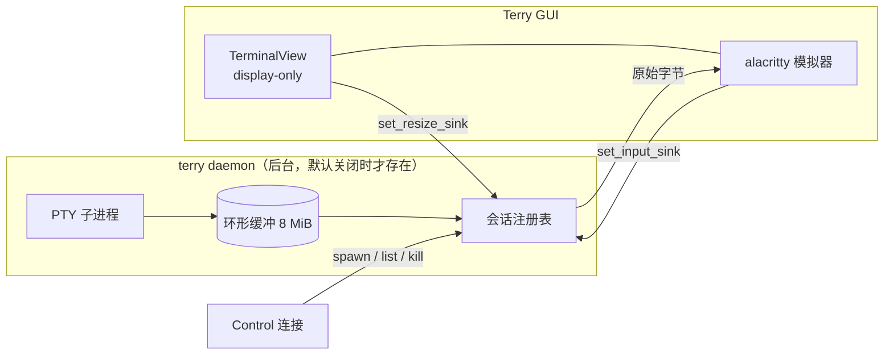

# 持久会话（终端 daemon）设计草案

状态：**设计待确认**。代码未改动（`crates/terminal_daemon` 与 `set_resize_sink` 已就绪）。

## 1. 目标与非目标

**目标**：开启后，终端进程由后台 daemon 持有。关掉 Terry、关掉窗口、SSH 断线，进程继续跑；重新打开 Terry 自动 reattach，并回放 scrollback。

**非目标（本阶段）**：
- 不做多机（远端 daemon）。
- 不做 TUI 客户端。
- 不支持 Windows（daemon crate 在非 Unix 平台返回 `Unsupported`）。
- 不改变默认行为：开关关闭时，走的仍是现有 `TerminalBuilder::new` + 进程内 PTY 路径。

## 2. 用户可见行为

```jsonc
// settings.json
"terminal": {
  "persistent_sessions": false   // 默认关闭
}
```

开启后：

| 操作 | 行为 |
|---|---|
| 新建终端 | daemon 里 spawn 一个 session，GUI attach |
| 关闭标签页 | kill 该 session（进程结束） |
| 退出 Terry（Cmd-Q / 关窗口） | 只断开 attach，session 继续运行 |
| 重新打开 Terry | 用持久化的 session id reattach，回放缓冲 |
| 终端内 `exit` | 收到 `Exited`，标签页显示退出状态，和现在一致 |
| daemon 不可用 / 启动失败 | 自动回退到普通 PTY 终端，并记一条日志 |

关闭开关后，已存在的 daemon session 不会被自动清理（可以用 `terry daemon list/kill` 处理）。

## 3. 数据流



关键取舍：**daemon 不渲染、不做模拟**。GUI 侧仍是完整的 alacritty 模拟器，只是输入输出接到了 socket。因此不需要 herdr 那套 surface delta 协议。

## 4. 会话身份与持久化

- 每个终端一个稳定 id：`t-<uuid v4>`，在创建时生成。
- 新增 `PersistedTerminal.daemon_session: Option<String>`（`#[serde(default, skip_serializing_if = "Option::is_none")]`），写进 `sessions/<key>.json`。
- 面板里维护 `terminal_daemon_sessions: HashMap<EntityId, String>`，和现有 `terminal_launches` 同构。
- 恢复时：把持久化的 id 传给 `Control::spawn`。`spawn` 是幂等的——id 还活着就直接返回，不起新进程；已经退出则用同样的 id 重新起一个 shell（并照常 replay `PersistedLaunch`）。

## 5. 生命周期矩阵

| 场景 | 现有行为 | 开启后 |
|---|---|---|
| 新建 | `project.create_terminal_shell_with_options` | `Control::spawn` + attach |
| 关闭标签 | 释放 PTY | `Control::kill` |
| 退出 App | 释放所有 PTY | 只 drop attach 连接 |
| 启动恢复 | 重放 launch 新建 shell | 同 id `spawn`（活着=reattach，死了=新建） |
| 移动标签到新窗口 | 同一 Entity 迁移 | 同一 attach 连接随 Entity 迁移，无需特殊处理 |
| tmux 镜像终端 | `add_mirrored_pane` | **不走 daemon**（tmux 自己就是持久层） |
| 任务（task）终端 | 普通 PTY | **不走 daemon**（短命进程，无收益） |
| detached session | 进程内保活 | 可选：关闭时改为 detach（见开放问题） |

## 6. 代码改动清单

### 6.1 设置项

| 文件 | 改动 |
|---|---|
| `crates/settings_content/src/terminal.rs` | `TerminalSettingsContent` 加 `pub persistent_sessions: Option<bool>`，文档注明默认 `false` |
| `crates/terminal/src/terminal_settings.rs` | `TerminalSettings` 加 `pub persistent_sessions: bool`；`from_settings` 里 `unwrap_or(false)`；补一条解析测试 |
| `crates/settings/src/vscode_import.rs` | 结构体字面量补 `persistent_sessions: None`（编译器会强制） |
| `crates/i18n/src/translations.rs` | 设置页文案（若要在 UI 暴露） |

### 6.2 环境变量复用（**最高风险项**）

daemon 负责 spawn shell，所以 GUI 现在在 `TerminalBuilder::new` 里做的环境准备必须搬过去，否则 shell 集成（OSC 133 / OSC 7）会失效，连带影响提示符跳转、命令历史、cwd 跟踪、agent 检测。

需要的环境：

- `terminal::insert_zed_terminal_env(...)`（已是 `pub`）：`TERM`、`COLORTERM`、`TERM_PROGRAM` 等。
- shell 集成：`shell_integration::inject_shell_integration_env(...)` 目前是 `pub(crate)`，需要改成 `pub`（或加一个公开包装）。
- `env.remove("SHLVL")`。
- 不转发 `GIT_PAGER` / `PAGER` 等启动器注入的覆盖项（`TerminalBuilder::new` 里已有这段逻辑）。
- profile 的 `env` 与 `shell`。

**建议**：把 `TerminalBuilder::new` 里的环境组装抽成

```rust
pub struct SpawnEnv { pub env: HashMap<String, String>, pub activation: Option<String> }
pub fn spawn_env(program: &str, extra: &HashMap<String, String>, cx: &App) -> SpawnEnv
```

两条路径都调用它，保证永远不会漂移。这是本次改动里唯一「不抽出来就一定会出事」的地方。

### 6.3 GUI 侧

新增 `src/persistent_sessions.rs`：

```rust
pub struct DaemonHandle { control: Mutex<Control> }          // 进程内单例
pub fn is_enabled(cx: &App) -> bool
pub fn spawn(session_id: String, spec: SessionSpec, cx: &mut App)
    -> Task<Result<Entity<Terminal>>>
```

`spawn` 内部：

1. `ensure_daemon(...)`：`UnixStream::connect` 失败时，用 `current_exe --daemon-serve --socket <path>` 拉起 daemon（`setsid` 脱离父进程组），轮询到 socket 可用为止。
2. `Control::spawn(spec)`。
3. `attach(...)` 拿到 `AttachedReader` / `AttachedWriter`。
4. `TerminalBuilder::new_display_only(...)` → `cx.new(|cx| builder.subscribe(cx))`。
5. `terminal.set_input_sink(Some(Arc::new(move |bytes| writer.input(bytes))))`。
6. `terminal.set_resize_sink(Some(Arc::new(move |cols, rows| writer.resize(cols, rows))))`。
7. 读线程：把 `AttachedReader` 放进独立 `std::thread`，通过 `async_channel` 把 `Event` 送给 GPUI task，task 里 `terminal.write_output(&bytes, cx)`；`Event::Exited(code)` 时把终端标记为退出。

> 读线程必须是阻塞线程：GPUI 的 background executor 是线程池，不适合长期阻塞读。参考现有 `add_mirrored_pane` 的 tmux 客户端线程写法。

`src/terminal_list_panel.rs`：

- `spawn_terminal` 里在 `project.create_terminal_shell_with_options(...)` 处分支：

```rust
let terminal = if persistent && !is_task && !is_tmux_mirror {
    match crate::persistent_sessions::spawn(daemon_id, spec, cx).await {
        Ok(terminal) => terminal,
        Err(error) => {
            log::warn!("persistent session unavailable, falling back: {error}");
            project.create_terminal_shell_with_options(...).await?
        }
    }
} else {
    project.create_terminal_shell_with_options(...).await?
};
```

- `PersistedTerminal` 增删字段、写/读 session 文件、`terminal_daemon_sessions` 映射。
- `remove_terminal_by_id` / `close_terminal_now` 里 `Control::kill(id)`（忽略错误：daemon 可能已经退出）。
- `clone_terminal`：克隆出来的终端应该是**新 session**（新 id），而不是共享同一个 PTY。

`src/ipc.rs`：`run_cli_subcommand` 增加隐藏子命令 `daemon-serve`，直接 `terminal_daemon::serve(&socket)` 并返回 `Some(0)`。这样不需要额外分发一个二进制。

`src/main.rs`：`mod persistent_sessions;`。

根 `Cargo.toml`：`terry` 的依赖加 `terminal_daemon.workspace = true`。

### 6.4 daemon crate

- `ensure_daemon` 改为接受「要启动的程序 + 参数」，由 GUI 传入 `current_exe --daemon-serve`，避免依赖 `terry-daemon` 是否随包分发。
- 可选：`serve` 增加 `--log FILE`，否则日志丢弃（daemon 是 `stderr=/dev/null`）。

## 7. 渲染与 scrollback

- display-only 终端初始为空；attach 后先收到 replay 缓冲（最多 8 MiB），据此重建屏幕与 scrollback。
- 回放不再一次性喂给模拟器：客户端只保留最后 1 MiB（切在行首，避免截断转义序列），再按 16 KiB 分片、每约 8 ms 让出前台一次。这样 debug 构建下也不会出现几秒的冻结；1 MiB 约等于默认 10k 行 scrollback，如果配置了更深的 scrollback，调大 `src/persistent_sessions.rs` 的 `MAX_REPLAY_BYTES`。
- kitty graphics / sixel / OSC 52 / OSC 8 都是原始字节，回放会原样重放，不需要特殊处理。
- 初始尺寸用 80×24，首次布局后由 `set_resize_sink` 纠正；TUI 程序可能会多刷一帧，可接受。

## 8. 失败处理

| 失败 | 处理 |
|---|---|
| daemon 启动失败 / 超时 | 回退普通 PTY，日志 warn |
| attach 失败（session 不存在） | 用同 id `spawn` 新建，再 attach |
| 读线程断开（daemon 崩溃） | 终端标记为 exited，提示用户；不自动重连（避免死循环） |
| kill 失败 | 忽略；session 可能已自行退出 |
| 设置开启但平台不支持（Windows） | 启动时 warn 一次，全部回退普通 PTY |

## 9. 安全

- socket 在 `/tmp/terry-<uid>/`，目录 `0700`、socket `0600`，只允许同用户访问。
- 不走网络，不监听 TCP。
- 已知限制：`/tmp` 路径可预测，但同用户可写目录已经限制了攻击面；跨用户攻击需要先拿到同 uid。

## 10. 测试计划

**自动化（已有）**：`cargo test -p terminal_daemon` 覆盖 spawn/attach/input/reattach 回放/list/kill/幂等 spawn/resize。

**自动化（待补）**：
- `TerminalSettings` 解析 `persistent_sessions`（默认 false）。
- 环境组装函数：`spawn_env` 的输出与 `TerminalBuilder::new` 一致（同一个测试同时断言两条路径）。

**手动验收**：

1. 打开开关，新终端里 `sleep 300`。
2. Cmd-Q 退出 Terry。
3. `terry daemon list` → session 在，`buffered_bytes > 0`。
4. 重新打开 Terry → 同一个 shell，scrollback 还在，`ps` 能看到进程没重启。
5. 拖动窗口改尺寸 → 终端里 `stty size` 反映新行列。
6. 关闭该标签 → `terry daemon list` 里消失，进程结束。
7. 关闭开关 → 新建终端行为与改动前完全一致。
8. 删除/改名 daemon 二进制 → 终端仍能打开（回退路径）。

## 11. 分阶段落地

| 阶段 | 内容 | 可独立验证 |
|---|---|---|
| P1 | 设置项 + spawn/attach + 关闭即 kill（不持久化 id） | 手动 1–5、7 |
| P2 | 持久化 `daemon_session` + 启动 reattach | 手动 1–4 |
| P3 | 重开已关闭标签时 reattach；agent 终端关闭改为 detach | 手动补充 |
| P4 | Windows（named pipe + ConPTY） | 独立项目 |

建议先做 P1，确认「关窗口不断任务」的体感，再决定是否投入 P2/P3。

## 12. 开放问题

1. **关闭标签 = kill 还是 detach？** 现在 agent 终端关闭后会进 `parked_agent_sessions`（进程内保活）。接入 daemon 后，这里更适合改成 detach，让 daemon 持有进程。
2. **daemon 是否跨 workspace/window 共享？** 建议共享（一个 daemon、session id 全局唯一），实现上 `Control` 做成进程内单例。
3. **孤儿 session 清理**：daemon 重启后 session 全丢；但 session 文件里残留的 id 需要能优雅处理（`spawn` 会新建）。真正需要清理的是「用户关闭开关后留下的旧 session」，可以先只提供 `terry daemon list/kill`。
4. **回放上限**：8 MiB 是否合适，需要真实使用后调。
5. **设置页是否暴露**：先只支持 settings.json，UI 后续再加。
